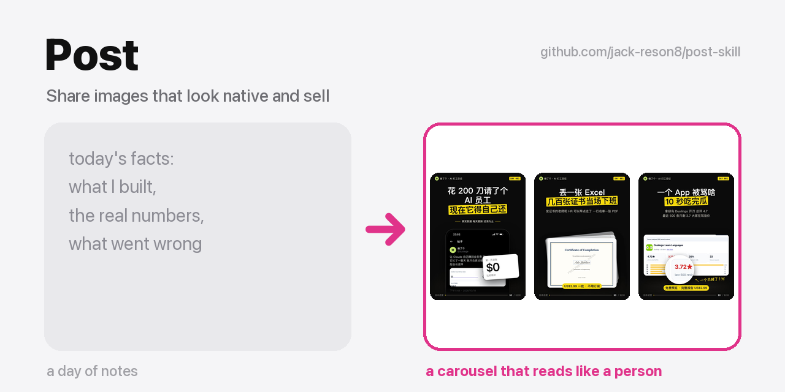
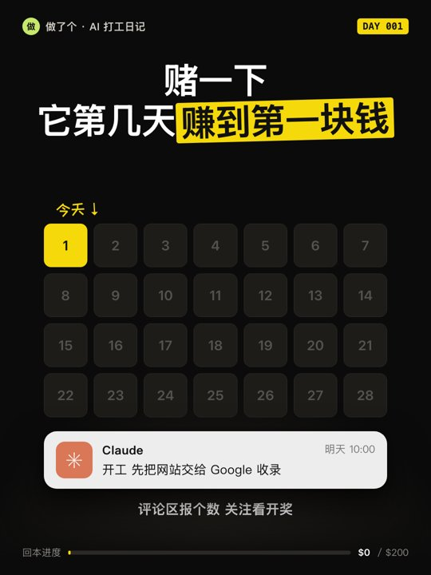

# Post · ネイティブに見えて、売れるシェア画像

[English](README.md) | [简体中文](README.zh-CN.md) | 日本語 | [한국어](README.ko.md) | [Tiếng Việt](README.vi.md) | [हिन्दी](README.hi.md)

<p align="center"></p>
<p align="center"><sub><a href="https://github.com/jack-reson8/copy-that"><b>Copy That</b></a> シリーズの一つ · 1 行で全部インストール</sub></p>
<p align="center"><a href="https://jack-reson8.github.io/skill-skill/check/"></a></p>

**今日の事実を Claude に渡すだけ。本物のアプリ画面のように見え、ユーモアのある人間の語り口で、あなたのプロダクトとシリーズを後押しする、小红书（Xiaohongshu）/ X 向けの画像セットができあがります。**

<table><tr>
<td></td>
<td></td>
<td></td>
<td></td>
<td></td>
</tr></table>
<sub>ビルド・イン・パブリックのシリーズ「Claude に月額 $200 のサブスク代を稼ぎ返させる」の 1 日目。このスキルで作成。</sub>

AI が作る投稿画像はたいてい同じ失敗をします。グラデーションのカード、絵文字のリスト、いかにもテンプレな「デザインされた」場面。このスキルは、実際に 7 回ボツにされ（「ダサい」「AI っぽい」「Claude らしくない」「真面目すぎ」）、ようやく採用されるまでの過程から生まれました。その修正メソッドをそのまま組み込んでいます。

| ステップ | Claude がやること |
|---|---|
| 1 · ブリーフ | `brief.md`：投稿の GTM 上の役割、シリーズのアイデンティティ、出典付きの事実リスト。画像に載せてよいのはこのリストの内容だけ |
| 2 · 参考 | プラットフォームのいいね上位カバーをグリッド化し、センスのあるアプリの App Store スクリーンショットを研究して、学びを 3 つ書く（ゲート） |
| 3 · ストーリーボード | 1 フレーム 1 行：見出し、根拠、浮かぶカード、ネタ、GTM 上の役割。必須：シリーズロゴ入りカバー、実際の出力と価格を見せるプロダクト画面、全面ナンバーページ、フォローへの導線 |
| 4 · コピー | まず素直な言葉で書き、そのあとネタライブラリから 1〜3 個を足す（問いかけ型タイトル、一行オチ、真顔ボケ、回収、落差のある結び） |
| 5 · 制作 | 本物のスマホスクリーンショット、ピクセル単位で再現した UI モック（X、Claude、iOS ロック画面、Google、Stripe）、表ではない図解、App Store ポスターテンプレート |
| 6 · レビュー | サムネイルサイズのコンタクトシートをチェックリストで確認 |
| 7 · 引き渡し | コンタクトシート＋タイトル案 2〜3 本。投稿するかどうかは常にあなた次第 |

## インストール

**Claude Code プラグインとして（推奨）**

```bash
claude plugin marketplace add jack-reson8/post-skill
claude plugin install post@post-skill
```

**通常のスキルとして**

```bash
git clone https://github.com/jack-reson8/post-skill
cp -R post-skill/plugins/post/skills/post ~/.claude/skills/
```
Google Chrome（ヘッドレスレンダリング用）と、コンタクトシート用に Pillow を入れた Python 3 が必要です。

**Codex（CLI または ChatGPT デスクトップアプリ）：**

```bash
codex plugin marketplace add jack-reson8/post-skill
codex plugin add post@post-skill
```

`plugins/post/skills/post` を `~/.codex/skills/` にコピーしても使えます。このスキルはオープンな [Agent Skills](https://agentskills.io) 標準に準拠しているため、Claude Code、Codex、SKILL.md を読めるあらゆるエージェントで動きます。

**その他のエージェント（Cursor、Gemini CLI、GitHub Copilot など、skills CLI 対応のエージェント）：**

```bash
npx skills add jack-reson8/post-skill
```

## 組み込みの誠実ルール
事実だけを使う。会話の UI モックは実際のやり取りの再現。他人のメッセージ、支払い、いいね、再生数を偽造しない。

## ライセンス
MIT。UI モックは解説・批評系の投稿のためにサードパーティ製アプリを模したもので、名称と商標はそれぞれの所有者に帰属します。

作者 [@jack-reson8](https://github.com/jack-reson8) · 姉妹スキル：[pro-motion](https://github.com/jack-reson8/pro-motion)、[skill-skill](https://github.com/jack-reson8/skill-skill)
